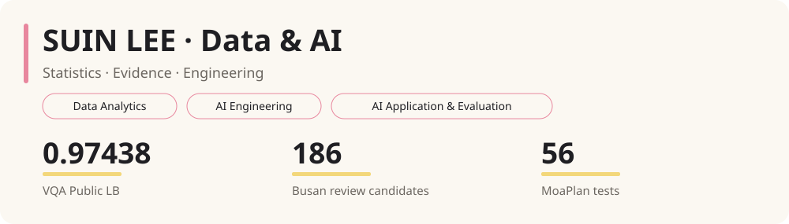
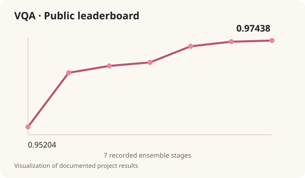
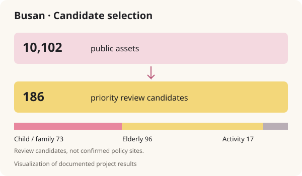

<picture>
  <source media="(prefers-color-scheme: dark)" srcset="assets/header-dark.svg">
  
</picture>

# 이수인 · Data & AI

**통계로 검증하고, 근거가 남는 데이터·AI 결과물을 만듭니다.**

정보통계학을 전공하고 SSAFY 16기 Python 트랙에서 AI 서비스 개발 역량을 쌓고 있습니다.
데이터의 품질, 모델의 평가 기준, 서비스의 재현 가능성을 함께 고려합니다.

[Portfolio](https://ssuinl.github.io) · [Email](mailto:suin020517@gmail.com)

## 핵심 역량

- **Data Analytics** — 통계적 분석, 공간 데이터 결합, 검증 설계
- **AI Engineering** — 멀티모달 모델 학습, LoRA/QLoRA, 앙상블
- **AI Application & Evaluation** — LLM Agent, RAG, 도구 호출, 기능 평가

## 대표 프로젝트

VQA·부산 그래픽은 기존 실험·분석 기록을 재시각화한 것이며, MoaPlan·Food Lab은 실제 실행 화면입니다.

### 01. Text Image VQA

`4인 팀 · 팀장` · 2026 · PyTorch, Transformers, PEFT

한국어 이미지 질의응답 모델의 학습과 확률 기반 앙상블을 설계했습니다. 학습·검증 데이터의 중복을 찾아 분리하고, 사전 채택 기준에 따라 실험을 비교했습니다.

- **Public LB 0.95204 → 0.97438**
- **검증 654/672문항 (97.32%)** — 반복 사용한 검증셋 기준

[프로젝트 상세 및 실험 노트북 →](https://github.com/ssuinl/ssafy-text-vqa)

 

---

### 02. 부산 유휴 공유재산 분석

`개인` · 2026.09 · pandas, NumPy, 공간 데이터 분석

유휴 공유재산과 생활인구를 결합해 행정동별 수요를 비교했습니다. 입지계수, 백분위 수요균형도, Pareto 분석으로 우선 검토 후보를 선정했습니다.

- **공유재산 10,102건 분석**
- **1차 행정 검토 후보 186건** — 실제 사업 대상 확정 아님

[프로젝트 상세 및 분석 노트북 →](https://github.com/ssuinl/busan-public-asset-analysis)

 

---

### 03. MoaPlan

`개인` · 2026.11 · LangGraph, FastAPI, Vue 3

금융 공시 API를 활용하여 목표에 맞는 저축 계획을 추천하는 Agent입니다. 금리와 납입 한도는 코드로 검증하고, 조건을 충족하지 못하면 재계획합니다.

- **3개 구조 · 27회 시나리오 평가**
- **자동 테스트 56개 통과** — 당시 기록 기준

[프로젝트 상세 및 설계·검증 문서 →](https://github.com/ssuinl/moaplan)

 

---

### 04. Food Lab RAG

`개인` · 2026.10 · LangChain, LangGraph, ChromaDB

공식 레시피와 위키 문서를 검색해 출처와 함께 답하는 RAG 서비스입니다. 메타데이터 필터링과 문서 캐시를 적용했습니다.

- **1,156건 색인 · 고유 레시피 1,149건**
- **자동 테스트 13개 통과** — 당시 기록 기준

[프로젝트 상세 및 검증 문서 →](https://github.com/ssuinl/food-lab-rag)

 

## 일하는 방식

- **기준을 먼저 정합니다.** 실험 결과를 보기 전에 채택 기준을 정하고, 작은 개선을 무조건 성과로 해석하지 않습니다.
- **누수를 확인합니다.** VQA에서 검증 문항 422개가 학습 데이터와 중복된 문제를 찾아 분리했습니다.
- **한계를 기록합니다.** 분석 후보와 실제 정책 대상, 시나리오 테스트와 일반화 성능을 구분합니다.

## 그 밖의 프로젝트

### 구현 · 분석 · 실험

| 프로젝트 | 내용 |
| --- | --- |
| [ETF Momentum](https://github.com/ssuinl/etf-momentum-backtest) | 36개 전략 조합, 체결 가정 및 블록 부트스트랩 비교 |
| [항만 선박 매칭](https://github.com/ssuinl/dacon-port-vessel-matching) | 한글 선박명 역음역과 후보 랭킹 |
| [고령운전자 이동 공백](https://github.com/ssuinl/dsz-elderly-driver-drt) | 교통 접근성 및 DRT 우선지역 분석 |
| [요일별 유동인구](https://github.com/ssuinl/bigcontest2026-weekday-floating-pop) | 격자 분포와 요일별 패턴 분석 |
| [고객 상담 Agent](https://github.com/ssuinl/aitop100-cs-agent) | 웹훅, LLM 도구 호출 및 모의 상담 흐름 |
| [AI 도서 추천](https://github.com/ssuinl/ai-book-recommend) | Django·FastAPI 기반 AI 웹 서비스 |
| [성평등 AI 실험](https://github.com/ssuinl/gender-fair-ai-benchmark) | 250문항 × 2개 조건, 응답 500개 제출 |
| [Firebase 채팅](https://github.com/ssuinl/firebase-realtime-chat) | 실시간 1:1 채팅, 일부 소스 복구 |

### 서비스 기획

| 프로젝트 | 내용 |
| --- | --- |
| [커리어WON케어](https://github.com/ssuinl/woori-career-won-care) | 우리은행 × SSAFY 경진대회 본선 장려상 |
| [PROOF](https://github.com/ssuinl/kic-proof-investment-claim-verifier) | SEC 공시 기반 투자 근거 검증 설계 |
| [GLOBAL FIT](https://github.com/ssuinl/global-fit-kfood-agent) | K-푸드 수출 시장 분석 Agent 기획 |

## 기술

- **주로 사용:** Python, pandas, NumPy, PyTorch, Transformers, PEFT, LangGraph, FastAPI
- **프로젝트 활용:** R, SQL, LightGBM, LangChain, ChromaDB, Django, Vue 3, Firebase, Git
- **전공 과정에서 활용:** SAS, SPSS

## 학력 · 교육 · 수상

- 단국대학교 정보통계학과
- SSAFY 16기 Python 트랙
- 우리은행 × SSAFY 우리WON뱅킹 아이디어 경진대회 장려상 (2026.11)
- 통계청 재능기부단 영상공모전 우수상 (2022)
- ADsP (2024.09)

## Contact

- [suin020517@gmail.com](mailto:suin020517@gmail.com)
- [ssuinl.github.io](https://ssuinl.github.io)
